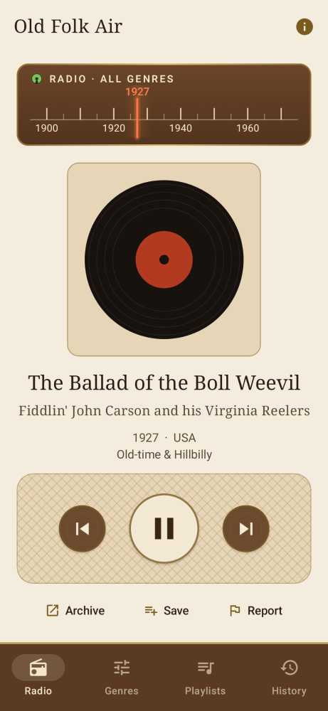
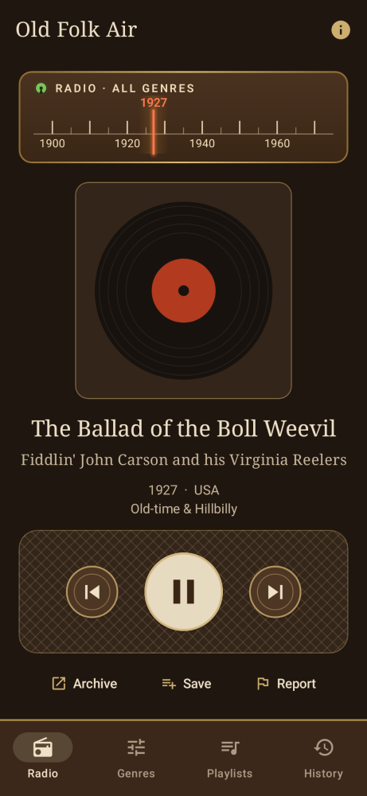
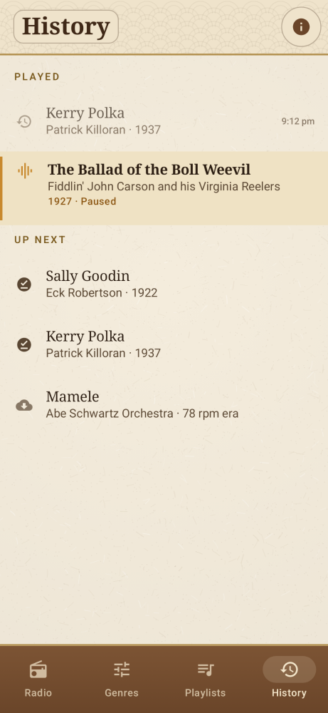
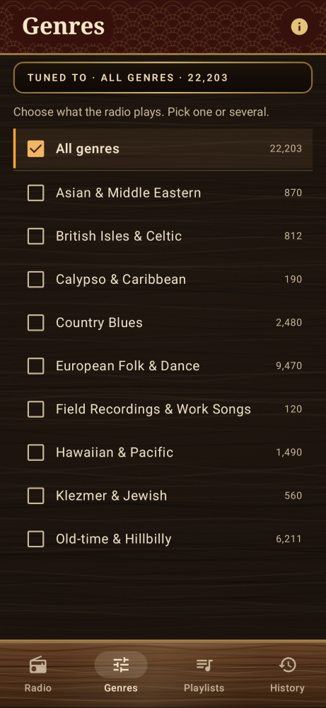

# Old Folk Air

## [⬇ Download the Android app (old-folk-air.apk)](https://github.com/TheHowardSmith/Old-Folk/releases/latest/download/old-folk-air.apk)

Open that link on your Android phone (Android 8 or newer), then open the downloaded file to install it. Android may ask you to allow installing apps from your browser. No account or sign-up is needed. All versions are on the [Releases page](https://github.com/TheHowardSmith/Old-Folk/releases).

---

Old Folk Air plays a never-ending random stream of public-domain folk and field recordings from around the world, streamed directly from the archives that hold them: the [Internet Archive](https://archive.org), the [Library of Congress](https://www.loc.gov/audio/), Finnish archives through [Finna](https://www.finna.fi) (the National Library of Finland and the Finnish Literature Society), the Instituto Moreira Salles' [Discografia Brasileira](https://discografiabrasileira.com.br), and the [Digital South Asia Library](https://dsal.uchicago.edu/LSI/)'s Linguistic Survey of India recordings. There is no streaming server: a vetted track list is published as small JSON files, and the app picks random tracks from it and plays them straight from the archive that holds them.

<p>




</p>

## What the app does

- **Endless radio:** random tracks, and your phone never repeats one until you've heard everything in your selection.
- **Genres:** pick one or more (old-time, blues, Celtic, klezmer, polka, calypso, Hawaiian, African, Indian and South Asian, Asian and Middle Eastern traditional music, field recordings...). Polka is a genre of its own, so it's easy to leave out.
- **Background playback:** keeps playing with the screen off, with notification and lock-screen controls.
- **Old-radio look:** a tuning dial whose needle points at the year of the recording, a green "magic eye" that glows while playing, bakelite-style knobs on a cloth grille. Light and dark themes.
- **Even volume:** each track gets a quick level read when it downloads so everything plays at about the same loudness, and a limiter dips the sudden thumps and pops common on unmastered 78 transfers. Transfers with sound on only one channel are played on both speakers, at the same loudness as everything else.
- **Skips very noisy recordings:** the same read checks for heavy surface noise (hiss band vs music band, plus spectral flatness), and the radio skips tracks where the noise swamps the music, about 15% of 78s. It can be switched off under About; playlists always play everything.
- **Smooth playback, even when skipping a lot:** 5 tracks are fetched ahead at first, then 20 ahead once you're streaming. Your last 20 tracks are kept too, so the previous button works instantly. Everything goes in a capped 600 MB cache, and tracks that won't play are skipped automatically. Fetching 20 ahead uses more mobile data.
- **History tab:** scroll up through everything you've ever streamed on this phone, and down through the tracks coming next. Older tracks aren't stored on the phone; tapping one streams it again.
- **Track details:** title, performer, year, region and genre, with a link to the recording's page at the archive that holds it.
- **Light on the archives:** each track is downloaded once and then played from the phone's cache. Recordings from smaller archives than archive.org are only fetched two tracks ahead, so skipping through the queue doesn't download files from them that nobody hears.
- **Playlists:** save tracks you like and play them back any time. They stream like the radio does.
- **Nothing to copy:** recordings are never saved to the phone as files. The playback cache is encrypted with a key held in the phone's secure keystore, so only the app can play it.
- **Report this track:** opens a pre-filled GitHub issue (rights concerns, wrong details, not folk...).
- **Failure reports:** tracks that fail to play or download are logged with the reason and whether the phone was online. From the About screen you can send them to this repository as a pre-filled issue, so we can check whether the file is really gone or it was a connection or app problem.

How it works: on first launch the app downloads `index.json` and one random part ("shard") of the track list, starts playing, and fetches the remaining shards in the background. Everything is cached; it only downloads again when the list version changes. Playback URLs are `https://archive.org/download/{item}/{file}`, or the full URL given in the track for other archives.

## Repository layout

| Path | What it is |
|---|---|
| `builder/` | Python tool that searches the Internet Archive and builds the track list |
| `builder/rules/` | Editable search queries, genre/region keywords and exclusion rules |
| `builder/overrides.yaml` | Manual review decisions (include/exclude items, approved writers) |
| `android/` | The Android app (Kotlin, Jetpack Compose, Media3/ExoPlayer, MediaSessionService) |
| `.github/workflows/` | CI, APK release, and track-list publishing |

## Building the track list

```bash
cd builder
python3 -m venv .venv && . .venv/bin/activate
pip install -e '.[test]'
oldfolk-build search            # find candidate items (fast)
oldfolk-build sample --n 200    # optional: pick a test sample
oldfolk-build fetch --sample    # fetch metadata (drop --sample for the full run)
oldfolk-build build --sample    # classify and write out-sample/ (or out/)
oldfolk-build ext-fetch         # optional: harvest loc.gov, Finna and DSAL (rules/loc.yaml, finna.yaml, dsal.yaml)
oldfolk-build ext-fetch --source ims --minutes 60   # optional, slow: Discografia Brasileira (5 s per page)
```

Fetching is polite (at most 2 requests at a time for the Internet Archive, one at a time with a pause for loc.gov, retries with backoff) and resumable: everything is cached in `builder/cache/oldfolk.sqlite`, so it can be stopped and restarted at any time. `build` works only from the cache, so rules can be tuned and re-run offline.

Output (not committed to git):

- `index.json`: list version, genres and shard list
- `s-<genre>-<n>.json`: the track list, about 5,000 tracks per shard
- `x-<genre>-<n>.json`: tracks from other archives (Library of Congress, Finna, Discografia Brasileira), listed under `ext` in the index so older app versions skip them
- `r-<genre>-<n>.json`: **review set**, flagged tracks that are kept out of the app until checked
- `flagged.csv`, `writers.csv`, `excluded.csv`, `report.md`: for manual review

Shard format (short keys): `{"v":1,"g":"oldtime","t":[{"i":"<item id>","f":"<file name>","t":"<title>","a":"<artist>","y":1928,"r":"<region>","g":"<genre>","p":1}]}`. `p` is the label/cover image: `1` means `<item id>_itemimage.jpg`, `2` means `<item id>_itemimage.png`, otherwise a file name; when absent the app uses the Archive thumbnail. Playback URL: `https://archive.org/download/{i}/{f}`. Tracks from other archives add `u` (full audio URL), `w` (web page) and `s` (the institution credited in the app), and their `i` is prefixed, e.g. `loc:flwpa000003`, `finna:sks.…`, `ims:19508`.

## Publishing

- **App:** every push to `main` that changes `android/` runs **Release APK**, which builds a signed APK and publishes it as the latest release (`old-folk-air.apk`). Signing uses the repository secrets `ANDROID_KEYSTORE_BASE64`, `ANDROID_KEYSTORE_PASSWORD`, `ANDROID_KEY_ALIAS` and `ANDROID_KEY_PASSWORD`.
- **Track list:** run the **Build track list** workflow (Actions tab → Build track list → Run workflow). `sample` builds a quick test list; `full` builds everything, resuming across runs (each run fetches for about 5 hours). The files are published to the `tracklist` release, which the app reads from `https://github.com/TheHowardSmith/Old-Folk/releases/download/tracklist/`.

To build the app yourself: install Android Studio (or JDK 17 plus the Android SDK), then run `cd android && ./gradlew assembleDebug`. UI screenshots are rendered without a device by Paparazzi: `./gradlew recordPaparazziDebug` (images in `android/app/src/test/snapshots/images/`).

## Selection rules

- Only recordings believed to have been **recorded or released in 1970 or earlier**.
- Undated 78 rpm discs are treated as pre-1970, because the format was obsolete by the mid-1960s.
- Items whose date looks unreliable (compilations, reissues, LPs dated before LPs existed, text mentioning later years, modern recordings of old songs) are **flagged for review**, not included.
- Songs credited to a named (non-traditional) writer are currently **kept**; their writers are listed in `writers.csv` and `builder/scripts/writer_deaths.py` estimates how many would need removing if composition copyright is enforced.
- Recordings whose descriptions say they are **restricted, sacred/secret or culturally sensitive are excluded**. Indigenous and ceremonial recordings are flagged for a human check.
- Non-Western classical and court traditions (raga, gagaku, nagauta, Cantonese music, Peking opera...) count as traditional music; Indian film songs count as pop.
- Jazz, pop (including Latin dance music such as tango and bolero), classical, opera, spoken word, and military/regimental bands are excluded, as are folk-dance instruction records (arranged studio versions made for dance classes, e.g. Folkraft or Michael Herman's Folk Orchestra).
- 78s graded **poor** or **worn** by the digitiser are excluded as too noisy.
- Recordings a rights owner claims in the US Copyright Office's **Pre-1972 Sound Recording Schedules** (matched by title and performer) are excluded, unless recorded in 1925 or earlier, when US protection has expired. The index is refreshed monthly by the track-list workflow.
- **Library of Congress** recordings come only from the historical folk field-recording collections listed in `builder/rules/loc.yaml` (the National Jukebox, licensed from Sony, is not used). Each item's own rights statement must say there are no known restrictions; anything else goes to the review set. Spoken word and transfers the Library describes as barely audible are left out.
- **Finna** recordings must be online with an open usage-rights code: public domain/free use (mostly the National Library of Finland's 78s) or CC BY-NC-ND (the Finnish Literature Society's field recordings, which the app streams unaltered, non-commercially and credited). Speech, Sámi joik (flagged for review) and anything after 1970 are left out.
- **Discografia Brasileira** recordings must already be in the public domain in Brazil by the site's own public-domain year (author's death + 70 and recording + 70 years) and be in a traditional or regional genre (toada, embolada, cateretê, coco, lundu, moda de viola, choro, baião...); popular-song genres such as samba and marcha are left out. The site is harvested at its requested pace of one page every 5 seconds, by its own scheduled workflow.
- **Linguistic Survey of India** gramophone recordings (1913–1929, Digital South Asia Library): only the songs, in some 40 Indian, Nepali and Burmese languages; speech samples are left out.
- No audio is ever stored in this repository.

## Rights notice

The recordings are hosted by the **Internet Archive**, the **Library of Congress**, the **National Library of Finland**, the **Finnish Literature Society**, the **Instituto Moreira Salles** and the **Digital South Asia Library**, not by this project, and are **not covered by this repository's licenses**. To the best of our knowledge they are no longer protected by copyright: every track meets the [selection rules](#selection-rules) above (recorded or released in 1970 or earlier, not claimed by a rights holder in the US Copyright Office's pre-1972 schedules, and no restrictions noted by the archive).

Rights holders who want a recording removed from the list can email **thehowardsmith@gmail.com**, or open an issue on this repository. Removed items are added to `builder/overrides.yaml` so they never return.

**Archives and libraries:** if you look after a collection of traditional or historical recordings and would like listeners to hear them through Old Folk Air, please get in touch at the same address. The app streams from your own servers, credits your institution on every track with a link back to your catalogue, and never copies or re-hosts your files.

## Licenses

- Code: [Apache License 2.0](LICENSE)
- Track list (the generated JSON metadata): [CC0 1.0](LICENSE-DATA)
